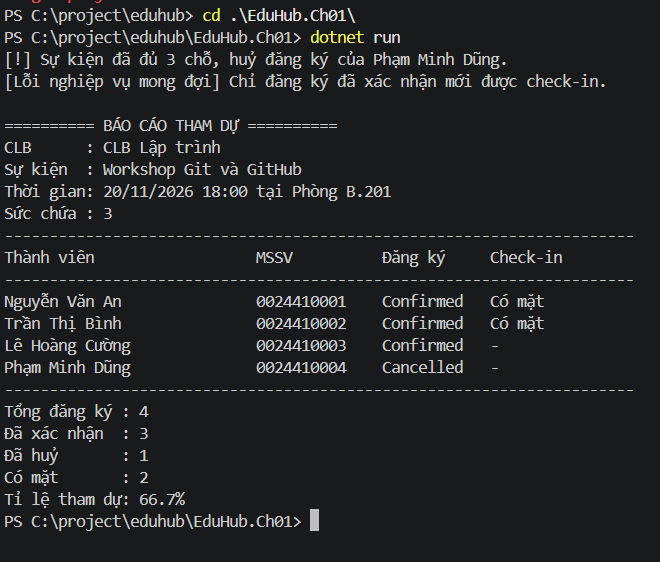

# EduHub – Bài tập Ch01

- Môn: IN421107 – Phát triển phần mềm hướng đối tượng
- Sinh viên: Trương Nguyễn Thiện Nhân – MSSV: 0024418147

## Nội dung
- [User Stories](USER_STORIES.md)
- [Sơ đồ lớp](CLASS_DIAGRAM.md)
- Domain classes: `EduHub.Ch01/Domain/`
- Console demo: `EduHub.Ch01/Program.cs`

## Cách chạy

cd EduHub.Ch01
dotnet run

## Thiết kế
- Thuộc tính dùng `private set`, constructor `private`, tạo đối tượng qua `Create()` có kiểm tra dữ liệu.
- `Club.Members` là `IReadOnlyList<Member>`, chỉ thay đổi qua `AddMember()` và `RemoveMember()`.
- Trạng thái phiếu đăng ký dùng enum `RegistrationStatus`.
- Khóa ngoại: `Event.ClubId`, `Registration.EventId`, `Registration.MemberId`, `CheckIn.RegistrationId`.

## Kết quả chạy `dotnet run`

