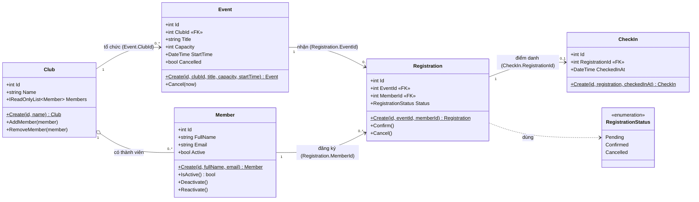

# Sơ đồ lớp EduHub (Mermaid)

## Giải thích quan hệ và khoá ngoại

| Quan hệ | Bội số | Khoá ngoại (phía "nhiều") |
|---|---|---|
| Club – Member | 1 – nhiều (danh sách `Members`) | không có FK, Club giữ danh sách |
| Club – Event | 1 – nhiều | `Event.ClubId` |
| Event – Registration | 1 – nhiều | `Registration.EventId` |
| Member – Registration | 1 – nhiều | `Registration.MemberId` |
| Registration – CheckIn | 1 – 0..1 | `CheckIn.RegistrationId` |
